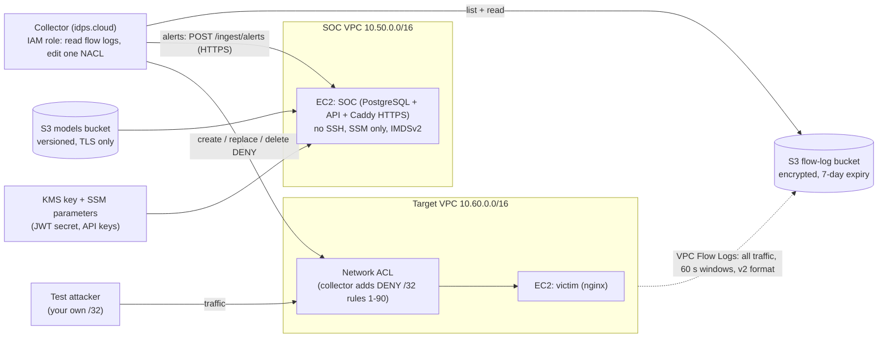
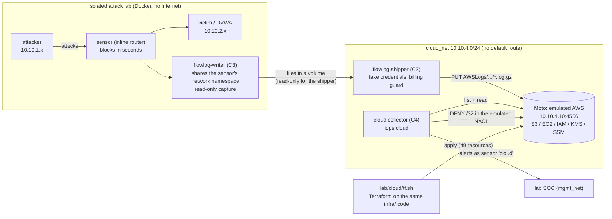

# Cloud architecture: the real AWS design and its free emulated twin

Draft, 18 Nov 2026 (step C5 of [cloud-plan.md](cloud-plan.md)). **C1 (emulator and Terraform) and
C3 (live flow-log exporter) are built and live-tested.** For C4 deployment see the [cloud lab guide](../lab/cloud/README.md). The [C6 demonstration guide](c6.md) covers the dashboard and verified classroom replay.

The project's cloud part has two forms that share the same code:

- **(a) The real design** (`infra/`, Terraform): what would run on AWS. It has never been applied to
  AWS, because the project has a hard rule: no AWS account, no card, no billing.
- **(b) The emulated twin** (`lab/cloud/`): the same Terraform applied to an open-source AWS
  emulator (Moto) on the lab machine, fed with the lab's real attack traffic.

## (a) The real AWS design

Every resource is in `infra/` (49 Terraform resources). Security choices worth naming in the report:
no SSH (Session Manager only), IMDSv2 only with hop limit 1, a customer-managed KMS key that only the
SOC role can decrypt (the victim role has an explicit Deny), all buckets private and TLS-only,
secrets kept out of Terraform state, and a budget stack with email alerts (`infra/budget/`).

## (b) The emulated twin

How the emulated twin keeps the rule "no billing, ever" (all checked by tests):

1. **Fake credentials only** (`test`/`test`), real `~/.aws` files hidden, every AWS call pinned to the
   emulator. `lab/cloud/guard.py` refuses to run if it sees a real-looking key, a profile or role, a
   proxy, a per-service endpoint, a non-local endpoint, or an account other than `000000000000`.
2. **Terraform only through `lab/cloud/tf.sh`:** guard first, then an emulator-only HTTP proxy
   (`egress_proxy.py`) that refuses every host except the emulator and every HTTPS tunnel; no
   `-chdir`, `-state` or `-var-file` options; the real `infra/` is copied, never changed, and its state is
   never mixed with the emulator's.
3. **The emulator cannot reach the internet:** its network namespace has no default route and accepts
   only TCP 4566 from `cloud_net` (`lab/cloud/netguard.sh`).
4. **The attack lab stays isolated:** the writer only listens (it keeps no capabilities after opening
   its socket and runs as an unprivileged user); the shipper sits on `cloud_net` only, in its own
   locked-down namespace with no default route and outbound only to the emulator, and mounts the
   writer's files read-only. The attacker and victim never gain a path to the cloud network or the
   internet (`lab/check_isolation.sh` passes with the exporter running).
5. **The shipper re-runs the billing guard** at start and every 5 minutes, and refuses to run if it
   fails. It never creates the bucket: if it is missing it stops and says to run `lab/cloud/tf.sh apply`.

Live check (C3): a port scan of the victim from the attacker produced two 60 s objects under
`AWSLogs/000000000000/vpcflowlogs/eu-west-1/<date>/` in the emulated bucket; the project's own
flow-log parser read them with no malformed lines (for example 304 records in one window, 296 of them
REJECT for the closed ports scanned, 8 ACCEPT). A shipper restart did not duplicate any object.

## Proof it is the same design

`terraform validate` passes and `terraform apply` of the unchanged `infra/` creates **all 49
resources** on the emulator (both VPCs, subnets, route tables, security groups, the target network ACL,
both instances, IAM roles and policies, the KMS key, both buckets and the VPC flow log). A second
`plan` shows *No changes*. Bucket tags need a second apply because Moto drops tags sent with
`CreateBucket` (see below).

Applying to the emulator also found **a real bug in `infra/`** that `validate` cannot see:
`data.aws_ssm_parameter.al2023[...].insensitive_value` does not exist (the attribute is
`insecure_value`), so a real `apply` would have failed too. It is fixed in `soc.tf` and `target.tf`.

## What differs from real AWS (state these in the report)

| Area | Real AWS | Emulated twin |
|---|---|---|
| EC2 instances | boot, run nginx and the SOC | records only; nothing boots |
| Network ACL | drops matching packets | rule is stored and shown (`describe-network-acls`) but **stops no packets**; the lab sensor does the real blocking |
| Flow logs | produced by AWS from its network | produced by our exporter from the lab's traffic **(C3)** |
| Flow-log delivery | AWS batches objects about every 5 minutes | the shipper uploads each finished 60 s window |
| REJECT records | security group or NACL denial | emulated: TCP to ports 22 and 80 is ACCEPT, other ports toward the victim are REJECT, and the victim's RST replies to rejected packets are dropped (a real security group would never have let them through). In the lab, the sensor's firewall and the victim decide what really happens |
| Flow-log "ENI" | one network interface of the instance | the victim side of the lab (10.10.2.0/24): both directions as separate records, captured once per packet |
| Capture | done inside AWS, no loss | a read-only packet capture loop in Python: a very heavy flood can be undercounted when the kernel buffer overflows (counts are low, never invented) |
| Bucket policy | `infra/` denies non-TLS requests | Moto ignores policy conditions, so that statement would deny every request. An emulator-only override (`lab/cloud/terraform/secure_bucket_override.tf`) keeps the statement but names an action nobody calls; `infra/` itself is unchanged |
| Account, region | a real account | `000000000000`, `eu-west-1` |
| Bucket tags | stored on `CreateBucket` | Moto drops them: first apply untagged, second apply tags them |
| S3 Control endpoint | account id in the host name resolves | needs the emulator-only proxy (`<account>.localhost` does not resolve in Go) |
| State | durable | in memory: after a restart delete the Terraform state and apply again |
| Cost | pay as you go | none |

## Open design points

- **C4: how the collector reaches the lab SOC.** The lab SOC accepts the sensor port (8444, mutual TLS)
  only from the sensor's address on `mgmt_net`, and `cloud_net` has no route to it. The collector needs
  either a second leg on `mgmt_net` with its own certificate and an `netguard.sh` rule, or to be run
  inside the sensor's namespace. The first option keeps the least privilege; to be decided in C4.
- **C2: the cloud model** is trained only on fields a flow log has (addresses, ports, protocol,
  packets, bytes, times, ACCEPT/REJECT). It cannot match the lab model's accuracy; the comparison is a
  finding to report (see [cloud.md](cloud.md)).

## C6 demonstration

Start the recorded-capture demonstration on the SOC dashboard's C6 page. It shows sensor decisions,
nftables membership, cloud alerts, the automatic response and an independent AWS CLI read-back
against Moto. The same page can observe an existing live run using SOC telemetry and collector logs.
See the [classroom setup and demonstration guide](c6.md).
